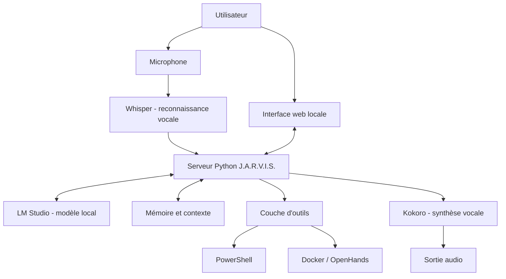

# J.A.R.V.I.S. — Assistant IA personnel

> Prototype personnel de recherche et de développement autour d'un assistant IA local, de la voix, des modèles de langage et de l'automatisation informatique.

  

  <strong>Prototype en développement</strong> · Documentation publique · Code source privé

**Autrice :** Anne Gabrielly Alves  
**Environnement principal :** Windows 11 · GPU NVIDIA  
**Dépôt :** vitrine technique — le code source interne n'est volontairement pas publié.

J.A.R.V.I.S. est un assistant personnel que je développe pour apprendre à faire communiquer plusieurs composants logiciels : un modèle de langage local, une application Python, une interface web, la reconnaissance vocale, la synthèse vocale et des outils d'automatisation.

L'objectif est de construire progressivement un assistant modulaire capable de comprendre des demandes, de dialoguer avec un modèle local et, à terme, d'aider sur des tâches informatiques avec des permissions contrôlées.

Ce dépôt a deux objectifs :
- présenter le projet, son architecture, les technologies étudiées et les difficultés rencontrées ;
- donner aux personnes intéressées une documentation structurée pour comprendre les composants et concevoir une solution similaire.

**Ce dépôt n'est pas une distribution prête à installer.** Le code, les scripts privés, les configurations propres à la machine et les secrets ne sont pas publiés. Les guides expliquent la démarche et les points à vérifier, mais ne prétendent pas fournir une installation reproductible du logiciel privé.

---

## Sommaire

- [Aperçu](#aperçu)
- [Pourquoi ce projet ?](#pourquoi-ce-projet-)
- [Objectifs et fonctionnalités](#objectifs-et-fonctionnalités)
- [Architecture](#architecture)
- [Composants et technologies](#composants-et-technologies)
- [Environnement de développement](#environnement-de-développement)
- [Comment reproduire une architecture similaire](#comment-reproduire-une-architecture-similaire)
- [État du projet](#état-du-projet)
- [Difficultés et enseignements](#difficultés-et-enseignements)
- [Sécurité et confidentialité](#sécurité-et-confidentialité)
- [Documentation](#documentation)
- [Compétences développées](#compétences-développées)
- [Feuille de route](#feuille-de-route)
- [À propos](#à-propos)

## Aperçu

L'image ci-dessus présente une vue visuelle du tableau de bord associé au projet. Elle sert d'illustration de l'interface et ne constitue pas une preuve que chaque fonction représentée est actuellement opérationnelle.

## Pourquoi ce projet ?

Les assistants IA reposent rarement sur un seul programme. Ils combinent généralement plusieurs services : un modèle de langage, une interface, des services audio, une couche applicative et parfois des outils capables d'interagir avec le système.

J'ai voulu comprendre comment ces briques peuvent être installées, configurées, testées et reliées sur un ordinateur personnel, en privilégiant l'exécution locale lorsque cela est possible.

Le projet est aussi un terrain d'apprentissage pratique autour de Python, Windows, Linux, Docker, des API locales, du GPU et du diagnostic de services.

## Objectifs et fonctionnalités

| Domaine | Objectif du projet | État connu |
|---|---|---|
| Conversation | Dialoguer avec un modèle de langage local | Expérimenté avec LM Studio et un serveur Python |
| Interface | Utiliser l'assistant depuis un navigateur | Interface locale développée et ouverte |
| Reconnaissance vocale | Transformer la parole en texte | Serveur Whisper large-v3 démarré et modèle chargé |
| Synthèse vocale | Générer une réponse audio | Kokoro démarré avec CUDA ; intégration complète à valider |
| Mémoire | Conserver du contexte entre les échanges | Variante de serveur avec mémoire explorée |
| Automatisation | Faciliter le démarrage des composants | Scripts PowerShell utilisés ou préparés |
| Outils de développement | Aider à analyser et travailler sur des projets | OpenHands et son environnement Docker expérimentés |
| Accès aux fichiers | Travailler sur un dossier autorisé | Objectif futur ; permissions et comportement à valider |

Les lignes « objectif » décrivent la direction du projet. Elles ne signifient pas que toutes les fonctions sont terminées.

## Architecture

Le schéma suivant représente l'architecture logique étudiée. Certains flux ont été testés séparément ; le fonctionnement complet de bout en bout reste à valider.

### Rôle des couches

1. **Interface utilisateur :** reçoit les demandes et affiche les réponses.
2. **Serveur applicatif :** coordonne les échanges entre l'interface, le modèle et les services.
3. **Modèle de langage :** interprète la demande et génère une réponse.
4. **Audio entrant :** Whisper transforme la voix en texte.
5. **Audio sortant :** Kokoro peut convertir un texte en parole.
6. **Outils :** PowerShell, Docker et OpenHands ont été étudiés pour assister certaines tâches.
7. **Mémoire :** piste de travail pour conserver les informations utiles entre les interactions.

## Composants et technologies

| Technologie | Utilisation dans le projet |
|---|---|
| Python | Serveur applicatif et intégration des composants |
| PowerShell | Scripts de lancement et automatisation sous Windows |
| LM Studio | Chargement et exposition locale de modèles de langage |
| Qwen et autres modèles locaux | Expérimentations avec différents modèles |
| Whisper large-v3 | Reconnaissance vocale |
| Kokoro | Synthèse vocale expérimentale |
| Docker | Exécution de composants dans des conteneurs |
| OpenHands | Expérimentation d'un environnement d'assistance au développement |
| CUDA | Accélération GPU pour les composants compatibles |
| Windows 11 | Environnement principal de développement |

Les versions exactes des logiciels et des modèles peuvent varier selon les essais. Elles ne sont pas indiquées lorsqu'elles n'ont pas été confirmées.

## Environnement de développement

Le prototype a été travaillé sur un PC Windows 11 équipé d'un GPU NVIDIA. Les services ont été lancés séparément afin de vérifier leur disponibilité et de consulter leurs journaux.

Le matériel principal utilisé est :
- processeur AMD Ryzen 7 9800X3D ;
- carte graphique NVIDIA GeForce RTX 5070 Ti ;
- mémoire vive 64 Go DDR5 ;
- stockage SSD NVMe.

Cette configuration décrit le poste de développement utilisé, pas une configuration minimale nécessaire pour exécuter une solution similaire.

## Comment reproduire une architecture similaire

Ce dépôt ne contient pas le code privé de J.A.R.V.I.S. Il n'est donc pas possible de cloner ce dépôt et de lancer le même assistant directement.

Pour construire un prototype comparable, une démarche possible est :

1. Préparer un environnement Python et vérifier les pilotes GPU.
2. Installer un outil d'exécution locale de modèles, puis vérifier son API locale.
3. Créer un petit serveur applicatif qui reçoit une demande et appelle le modèle.
4. Construire une interface web minimale et la relier au serveur.
5. Ajouter la reconnaissance vocale comme service indépendant.
6. Ajouter la synthèse vocale comme service indépendant.
7. Tester chaque composant séparément avant de connecter la chaîne complète.
8. Ajouter progressivement la mémoire, les outils et l'automatisation.
9. Isoler les tâches sensibles et limiter les permissions.
10. Documenter les versions, les paramètres et les tests réellement effectués.

Pour chaque composant, il faut noter la version, le système utilisé, les dépendances, la méthode de démarrage, le résultat attendu et les erreurs rencontrées. Les guides de ce dépôt détaillent cette démarche sans inventer les paramètres privés de l'application.

## État du projet

### Composants dont le démarrage ou le chargement a été observé

- LM Studio utilisé pour charger et exposer des modèles locaux.
- Serveur Whisper lancé avec le modèle large-v3 chargé sur GPU, CUDA et calcul float16.
- Service Kokoro démarré avec CUDA et ses ressources vocales détectées.
- Interface web J.A.R.V.I.S. ouverte dans un navigateur.
- Interface OpenHands et environnement runtime expérimentés avec Docker.
- Scripts PowerShell utilisés ou préparés pour faciliter le lancement.

### Points qui restent à valider

- conversation vocale complète : microphone → transcription → modèle → synthèse → lecture ;
- stabilité de la détection du microphone et de la sortie audio ;
- démarrage coordonné et fiable de tous les services ;
- comportement exact de la mémoire entre plusieurs sessions ;
- accès aux fichiers avec permissions limitées ;
- exécution d'actions avec confirmation, journalisation et possibilité d'annulation.

La distinction entre « démarré », « testé séparément » et « validé de bout en bout » est importante. Elle évite de présenter un prototype comme un produit terminé.

## Difficultés et enseignements

Les expérimentations ont notamment mis en évidence plusieurs points :

- un service audio peut démarrer correctement sans que le microphone ou la lecture audio fonctionne dans l'application ;
- la compatibilité entre versions de bibliothèques, PyTorch, CUDA et pilotes GPU doit être vérifiée ;
- plusieurs services indépendants nécessitent une orchestration fiable ;
- les journaux de démarrage sont essentiels pour identifier le composant qui échoue ;
- l'accès d'un assistant aux fichiers et aux commandes doit être conçu avec des limites de sécurité dès le départ.

## Sécurité et confidentialité

Ce dépôt est une vitrine publique et non une distribution du logiciel.

Ne sont pas publiés :
- le code source privé et les scripts internes ;
- les mots de passe, clés API, tokens et autres secrets ;
- les adresses IP privées et détails d'accès réseau ;
- les configurations contenant des données personnelles ;
- les fichiers de travail et données privées.

Toute fonction future d'accès aux fichiers, d'exécution de commandes ou d'accès Internet devra respecter le principe du moindre privilège : autorisations explicites, périmètre limité, confirmation des actions sensibles, isolation et journaux d'activité.

Voir [SECURITY.md](SECURITY.md) pour les règles de sécurité du dépôt.

## Documentation

| Document | Contenu |
|---|---|
| [Architecture technique](docs/ARCHITECTURE.md) | Vue d'ensemble, composants et flux |
| [Guide de mise en place](docs/INSTALLATION-GUIDE.md) | Démarche pour construire un environnement similaire |
| [Composants](docs/COMPONENTS.md) | Rôle des technologies et état de validation |
| [Configuration](docs/CONFIGURATION.md) | Principes de configuration et paramètres à documenter |
| [Dépannage](docs/TROUBLESHOOTING.md) | Problèmes rencontrés et méthode de diagnostic |
| [Journal de développement](docs/DEVELOPMENT-LOG.md) | Historique des expérimentations |
| [Feuille de route](docs/ROADMAP.md) | Étapes envisagées |
| [Sécurité](SECURITY.md) | Protection des secrets et limites d'accès |

## Compétences développées

- développement et intégration en Python ;
- automatisation Windows avec PowerShell ;
- utilisation de modèles de langage locaux ;
- intégration de services de reconnaissance et de synthèse vocales ;
- gestion de services et diagnostic à partir des journaux ;
- conteneurisation avec Docker ;
- expérimentation d'outils d'assistance au développement ;
- utilisation de CUDA et diagnostic de compatibilité GPU ;
- conception d'une architecture modulaire ;
- documentation technique et suivi des tests.

## Feuille de route

- [ ] Stabiliser le démarrage coordonné des services.
- [ ] Valider séparément microphone, transcription, synthèse et lecture.
- [ ] Tester la conversation vocale complète.
- [ ] Définir et tester la persistance de la mémoire.
- [ ] Décrire les interfaces et contrats entre services.
- [ ] Ajouter des tests reproductibles et des journaux structurés.
- [ ] Définir un modèle de permissions pour les fichiers et les commandes.
- [ ] Préparer une démonstration publique expurgée des informations privées.

## À propos

Je suis Anne Gabrielly, basée dans le canton de Vaud, en Suisse, et actuellement en formation en développement Web et Web Mobile chez Skill&You Suisse. Je m'intéresse au support informatique, aux systèmes, au hardware, au développement et à l'intelligence artificielle appliquée.

J.A.R.V.I.S. est un projet personnel d'apprentissage et d'expérimentation. Il me permet de mettre en pratique plusieurs domaines de l'informatique dans un même projet concret.

- **Portfolio :** https://annegaaby.github.io/Anne-Gabrielly/
- **GitHub :** https://github.com/AnneGaaby

*Les noms des produits et technologies cités appartiennent à leurs détenteurs respectifs.*
