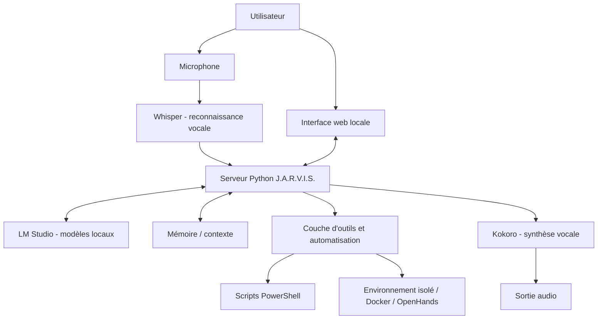

# J.A.R.V.I.S. — Assistant IA personnel

> Projet personnel de recherche et de développement : concevoir un assistant IA local capable de dialoguer, d'utiliser des modèles de langage exécutés sur la machine, de traiter la voix et de servir d'interface à des outils d'automatisation.

**Autrice :** Anne Gabrielly Alves  
**Statut :** prototype personnel en développement  
**Type de dépôt :** vitrine technique publique — le code source interne n'est pas publié.

J.A.R.V.I.S. est un projet que je développe pour explorer l'intégration de plusieurs briques d'intelligence artificielle et d'automatisation dans un assistant personnel. L'objectif est de rapprocher un modèle de langage local, une interface utilisateur, la reconnaissance vocale, la synthèse vocale et des outils capables d'assister des tâches informatiques concrètes.

Ce dépôt présente le contexte, les choix techniques, l'architecture étudiée, les composants expérimentés et les enseignements du projet. Il ne contient volontairement ni le code privé de l'assistant, ni les scripts d'automatisation internes, ni les données de travail.

---

## Sommaire

- [Objectifs](#objectifs)
- [Fonctionnalités et périmètre](#fonctionnalités-et-périmètre)
- [Architecture générale](#architecture-générale)
- [Technologies et composants](#technologies-et-composants)
- [Environnement de développement](#environnement-de-développement)
- [Parcours de développement](#parcours-de-développement)
- [État réel du projet](#état-réel-du-projet)
- [Sécurité et confidentialité](#sécurité-et-confidentialité)
- [Compétences mobilisées](#compétences-mobilisées)
- [Évolutions envisagées](#évolutions-envisagées)

## Objectifs

Le projet explore la création d'un assistant personnel qui puisse :

1. recevoir des demandes en langage naturel ;
2. interroger un modèle de langage exécuté localement ;
3. comprendre des commandes vocales grâce à la reconnaissance de la parole ;
4. répondre par texte et, lorsque la chaîne audio est opérationnelle, par la voix ;
5. fournir une interface web locale ;
6. conserver du contexte et une mémoire de travail ;
7. aider à analyser des fichiers et des projets de développement ;
8. assister des tâches de programmation, de diagnostic et d'automatisation ;
9. utiliser des outils externes ou un environnement d'exécution lorsque cela est configuré et autorisé.

L'idée directrice est de construire un système modulaire : chaque service a une responsabilité précise et peut être testé indépendamment.

## Fonctionnalités et périmètre

Les éléments ci-dessous distinguent les composants réellement installés ou expérimentés des objectifs encore en cours de validation.

| Domaine | Travail réalisé ou expérimenté |
|---|---|
| Assistant local | Développement d'un serveur Python et d'une interface web dédiée |
| Modèles IA | Utilisation de LM Studio et expérimentation avec des modèles locaux |
| Reconnaissance vocale | Serveur Whisper installé, modèle large-v3 chargé sur GPU |
| Synthèse vocale | Service Kokoro lancé avec accélération CUDA ; validation complète de la réponse vocale dans l'application à poursuivre |
| Automatisation | Scripts PowerShell pour orchestrer le démarrage de l'environnement |
| Environnement d'exécution | Expérimentations avec Docker et OpenHands |
| Mémoire | Variante de serveur avec mémoire explorée |
| Interface | Interface locale accessible depuis un navigateur |
| Assistance au développement | Objectif d'analyse de fichiers, de diagnostic et d'aide sur des projets personnels |

Les capacités telles que l'exécution autonome de tâches, l'accès contrôlé à un dossier de projets, la mémoire persistante complète et le cycle vocal de bout en bout sont des objectifs de développement. Elles ne sont pas présentées ici comme des fonctions finalisées ou garanties.

## Architecture générale

Le schéma décrit l'architecture logique explorée. Il ne représente pas une promesse que tous les flux sont déjà intégrés et validés de bout en bout.

### Rôle des composants

- **Interface web :** point d'interaction avec l'assistant depuis le navigateur.
- **Serveur Python :** couche applicative qui coordonne les demandes et les services.
- **LM Studio :** expose localement les modèles de langage utilisés pendant les expérimentations.
- **Whisper :** transforme la parole en texte.
- **Kokoro :** composant de synthèse vocale expérimenté pour produire une réponse audio.
- **PowerShell :** automatise certaines opérations de lancement et d'orchestration sous Windows.
- **Docker / OpenHands :** environnement exploré pour exécuter des outils et assister des tâches de développement.
- **Mémoire :** piste de travail pour conserver le contexte entre les interactions.

## Technologies et composants

### Langages et scripts

- **Python** — serveur applicatif et intégration des composants.
- **PowerShell** — automatisation et lancement de services sous Windows.

### Intelligence artificielle et audio

- **LM Studio** — exécution et exposition locale de modèles de langage.
- **Whisper large-v3** — reconnaissance vocale.
- **Kokoro** — synthèse vocale, avec expérimentation de l'accélération GPU.
- **Modèles locaux** — essais avec différentes familles de modèles, notamment des modèles Qwen ; Gemma a également été envisagé comme modèle cible.

### Conteneurs et outils d'exécution

- **Docker** — lancement et gestion de composants isolés.
- **OpenHands** — environnement d'assistance au développement expérimenté.
- **CUDA** — accélération GPU pour les composants compatibles.

### Système et environnement

- **Windows 11**
- **GPU NVIDIA**
- **Environnement Python**
- **Services locaux accessibles sur la machine de développement**

## Environnement de développement

Le prototype a été développé et testé sur un poste Windows 11 équipé d'un GPU NVIDIA. Les composants ont été lancés comme services locaux distincts afin de pouvoir examiner leur disponibilité et leurs journaux indépendamment.

Exemples de composants et points de contrôle utilisés pendant le développement :

| Composant | Vérification effectuée |
|---|---|
| LM Studio | Vérification de la disponibilité de l'API locale |
| Whisper | Contrôle de santé du service et chargement du modèle |
| Kokoro | Vérification des journaux de démarrage et du chargement du modèle sur CUDA |
| Interface J.A.R.V.I.S. | Ouverture de l'interface dans le navigateur |
| OpenHands | Démarrage de l'interface et du runtime dans l'environnement Docker |

Les adresses locales, ports exacts, variables d'environnement et paramètres propres à la machine ne sont pas publiés dans ce dépôt. Ils peuvent varier selon l'installation.

## Parcours de développement

Le travail a été mené par étapes, en testant les composants séparément avant de chercher à les coordonner.

### 1. Mise en place du poste et des services locaux

- Préparation de l'environnement Windows.
- Installation et lancement de LM Studio.
- Vérification de l'accès local aux modèles.
- Mise en place de Docker et expérimentation avec des images OpenHands et runtime.

### 2. Serveur applicatif et interface

- Travail sur un serveur Python, notamment autour des fichiers de projet `server.py` et `server_com_memoria.py`.
- Développement d'une interface J.A.R.V.I.S. accessible depuis un navigateur.
- Vérification du démarrage du serveur et de l'ouverture de l'interface.
- Exploration d'une variante intégrant une mémoire de conversation.

### 3. Reconnaissance vocale

- Installation et démarrage d'un serveur Whisper.
- Chargement du modèle `large-v3`.
- Vérification du statut du service : modèle chargé, périphérique CUDA et calcul en précision float16.
- Tests du chemin microphone vers la reconnaissance vocale.

### 4. Synthèse vocale

- Déploiement expérimental d'un service Kokoro.
- Résolution d'un premier problème de démarrage lié à la compatibilité de l'environnement logiciel et du GPU.
- Démarrage ultérieur du service avec CUDA, chargement du modèle et des packs de voix.
- La validation complète de la lecture audio depuis l'interface J.A.R.V.I.S. reste à documenter.

### 5. Automatisation du démarrage

Un script PowerShell, `Automacao_JARVIS.ps1`, a été utilisé dans le travail d'orchestration. Des fichiers de lancement complémentaires ont également été envisagés ou préparés au cours des essais. Les scripts internes ne sont pas inclus dans cette vitrine publique.

### 6. Expérimentation d'un environnement d'assistance au développement

- Téléchargement et lancement d'images Docker OpenHands.
- Vérification du démarrage de l'interface web.
- Exploration du runtime et de la possibilité de déléguer des tâches de développement.
- Étude d'un accès encadré à un dossier de projets personnels.

## État réel du projet

J.A.R.V.I.S. est un prototype évolutif. Plusieurs composants ont été installés et testés individuellement, mais leur intégration complète est un travail en cours.

**Composants dont le démarrage ou le chargement a été observé :**
- LM Studio et des modèles locaux pendant les expérimentations.
- Serveur Whisper avec le modèle large-v3 chargé sur GPU.
- Service Kokoro démarré avec CUDA et modèle chargé.
- Interface web J.A.R.V.I.S. ouverte depuis le navigateur.
- Interface OpenHands lancée dans l'environnement Docker.

**Points qui nécessitent encore une validation de bout en bout :**
- conversation vocale complète : microphone, transcription, réponse du modèle et restitution audio ;
- fiabilité de la détection du microphone et de la lecture audio ;
- orchestration stable de tous les services au démarrage ;
- mémoire persistante et gestion du contexte ;
- exécution d'actions avec permissions limitées et journalisation ;
- accès contrôlé aux fichiers d'un projet.

Cette distinction est volontaire : documenter précisément ce qui fonctionne, ce qui a été testé séparément et ce qui reste à construire fait partie d'une démarche d'ingénierie sérieuse.

## Sécurité et confidentialité

Ce dépôt est une présentation publique, pas une distribution du logiciel.

Pour protéger le projet et les environnements associés, ne sont pas publiés :

- le code source privé de l'assistant ;
- les scripts internes d'automatisation ;
- les clés API, mots de passe, tokens ou secrets ;
- les adresses IP privées et détails d'accès réseau ;
- les fichiers de configuration contenant des informations personnelles ;
- les données de projets ou de clients.

Toute future fonction permettant à l'assistant de lire ou modifier des fichiers, d'exécuter des commandes ou d'utiliser Internet doit être limitée par des permissions explicites, une séparation des environnements, une validation des actions sensibles et des journaux d'activité.

## Compétences mobilisées

Ce projet personnel m'a permis de pratiquer et d'explorer :

- intégration de services Python ;
- automatisation sous Windows avec PowerShell ;
- utilisation de modèles de langage locaux ;
- reconnaissance et synthèse vocales ;
- déploiement de services et diagnostic à partir des journaux ;
- conteneurisation avec Docker ;
- expérimentation d'environnements d'assistance au développement ;
- intégration de composants accélérés par GPU ;
- analyse de problèmes de compatibilité et de démarrage ;
- conception progressive d'une architecture modulaire.

## Évolutions envisagées

- Stabiliser le démarrage coordonné des composants.
- Finaliser et tester la chaîne vocale complète.
- Clarifier la gestion de la mémoire et du contexte.
- Ajouter une gestion des permissions pour les outils.
- Documenter les interfaces entre les services.
- Mettre en place des tests reproductibles et des journaux structurés.
- Réaliser une démonstration vidéo sans exposer les éléments privés.

---

## À propos

Je suis Anne Gabrielly, basée dans le canton de Vaud, en Suisse, et actuellement en formation en développement Web et Web Mobile chez Skill&You Suisse. Je m'intéresse au support informatique, aux systèmes, au hardware, au développement et à l'intelligence artificielle appliquée.

J.A.R.V.I.S. est l'un de mes projets personnels : un terrain d'apprentissage concret pour comprendre comment plusieurs technologies peuvent fonctionner ensemble dans un système cohérent.

- **Portfolio :** https://annegaaby.github.io/Anne-Gabrielly/
- **GitHub :** https://github.com/AnneGaaby

*Ce dépôt décrit un projet personnel en développement. Les noms de produits et technologies appartiennent à leurs détenteurs respectifs.*
