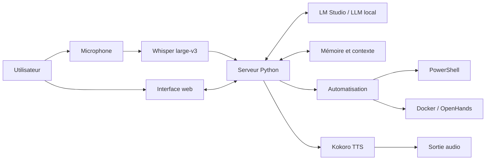

# Architecture technique — J.A.R.V.I.S.

Ce document décrit l'architecture logique explorée dans le prototype. Il distingue les composants identifiés des intégrations qui doivent encore être validées.

## Vue d'ensemble

## Composants

| Couche | Composant | Responsabilité |
|---|---|---|
| Présentation | Interface web locale | Saisie et affichage des échanges |
| Application | Serveur Python | Coordination des requêtes et des services |
| IA | LM Studio | Exposition locale de modèles de langage |
| Audio entrant | Whisper large-v3 | Transcription de la parole |
| Audio sortant | Kokoro | Synthèse vocale expérimentale |
| Automatisation | PowerShell | Scripts et orchestration sous Windows |
| Exécution isolée | Docker / OpenHands | Expérimentation d'outils d'assistance au développement |
| Contexte | Module de mémoire exploré | Continuité des échanges |

## Flux d'une interaction textuelle (logique visée)

1. L'utilisateur saisit une demande dans l'interface.
2. Le serveur Python reçoit la demande.
3. Le serveur prépare le contexte et sollicite le modèle local configuré.
4. La réponse est renvoyée à l'interface.
5. Si la sortie vocale est activée et reliée, le texte peut être transmis au service de synthèse.

## Flux vocal (logique visée)

1. Le microphone capture la voix.
2. Whisper transcrit l'audio en texte.
3. Le serveur Python transmet le texte au modèle local.
4. Le serveur reçoit une réponse.
5. Kokoro peut générer une sortie audio si le service et la lecture sont correctement intégrés.

La chaîne complète a fait l'objet d'essais partiels. La validation de bout en bout reste un point de travail.

## Séparation et sécurité

Les services sont exécutés localement et séparément. Les détails d'adressage, ports, jetons et paramètres de configuration spécifiques à la machine sont volontairement exclus de la documentation publique.

Les fonctions futures d'accès aux fichiers et d'exécution de commandes devront appliquer le principe du moindre privilège : accès limité aux dossiers autorisés, confirmation des actions sensibles, isolation des tâches et journalisation.
